

  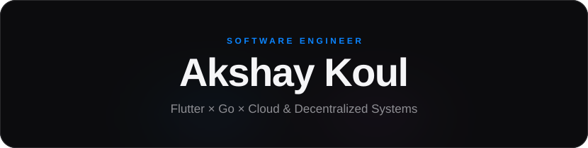

<b>I build the tools that let anyone build apps.</b>

  
  
  

<!-- 

  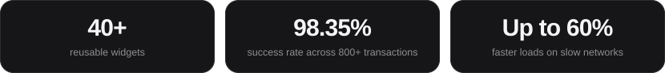

 -->

 

<h2 align="center">Work</h2>

  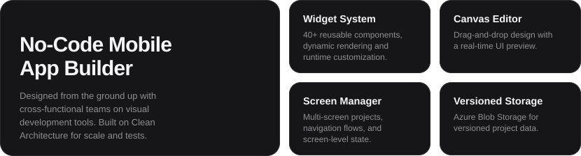

 

<h2 align="center">Projects</h2>

  <a href="https://github.com/AKSHAYK0UL/Koul-Network">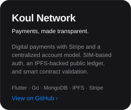</a>&nbsp;&nbsp;&nbsp;
  <a href="https://github.com/AKSHAYK0UL/Nex-Music">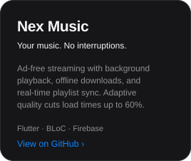</a>&nbsp;&nbsp;&nbsp;
  <a href="https://github.com/AKSHAYK0UL/Ghost">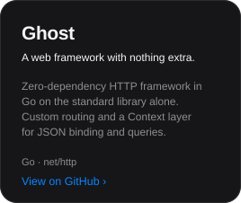</a>

  Also: <a href="https://github.com/AKSHAYK0UL/IPFS">IPFS</a> &nbsp;·&nbsp;
  <a href="https://github.com/AKSHAYK0UL/Go-SMTP-Email-Forwarder">Go SMTP Email Forwarder</a> &nbsp;·&nbsp;
  <a href="https://github.com/AKSHAYK0UL/Nex-Social">Nex Social</a>

 

<h2 align="center">Tech Stack</h2>

  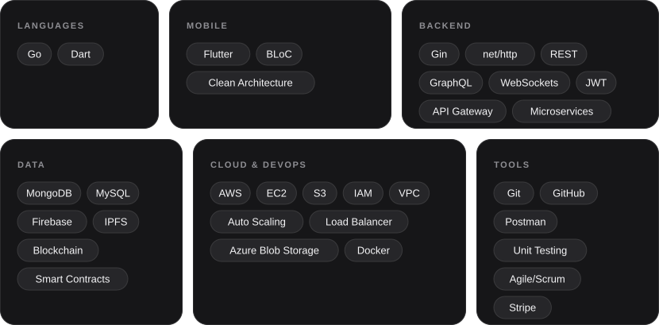

 

<h2 align="center">Activity</h2>

  

<!-- ACTIVITY:START -->

  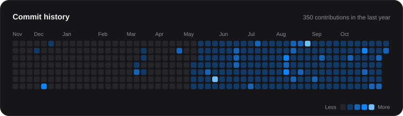
   
  <a href="years/2025.md">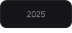</a> 
  <a href="years/2024.md">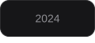</a> 
  <a href="years/2023.md">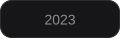</a>

 
<!-- ACTIVITY:END -->

 

Always learning. Always shipping.

